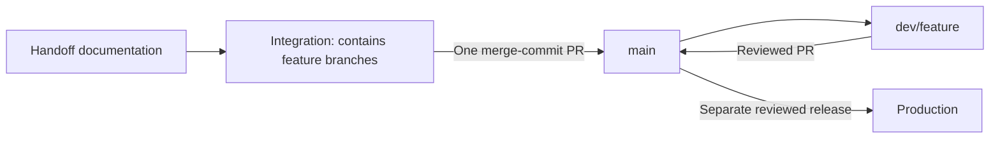

# Consolidate development into `main`

## Execution update · 2026-11-24

**Fact:** [PR #5](https://github.com/davidmagbee/RepairVantage/pull/5) merged integration `5b513d9` into `main` at `ca8fe43cff0bf9167d48c4e98b398dc037732b5a`, preserving ancestry. PR Verify passed and independent source review found no consolidation blocker. A fresh local run passed 48 Node and 71 Chromium tests (99.03% lines, 96.82% branches), lint/build and built-package desktop/mobile checks. Resulting main CI passed; after PR #6 at `678d25e` also passed main CI, five contained local/remote branches were pruned: portfolio-ui, report-export-demo, handoff-main-consolidation, engineering-harness and runtime-audit-fix. A temporary clean main worktree, current PR/worktree checks, both-tip ancestry and exact deletion leases guarded cleanup. The commands below preserve the original plan for reference; **do not open another consolidation PR**. Future PRs target `main`.

**Fact:** Vercel still had no Git link at the execution recheck. The scoped Effect dependency patch passed and merged through PR #6; UI source472cd93 was separately promoted. Merging source did not itself deploy or apply migrations. The earlier baseline below is historical, not the current branch state.

## Verified baseline · 2026-11-18

**Fact** · GitHub's default branch is already `main`, at `bd46f74`. [PR #3](https://github.com/davidmagbee/RepairVantage/pull/3) merged the portfolio UI into `dev/engineering-harness` at `5d46f844a23f8d9e536853eca1498947fd6ff892`. That integration commit has the same tree as UI branch tip `039ae0b`; `main` is its ancestor and lacks 38 integration commits. Subsequent documentation merges will increase that count.

**Fact** · Both feature tips are contained in integration: `dev/portfolio-ui` at `039ae0b` and `dev/report-export-demo` at `fe17d2f`. They are not yet contained in `main`. At the initial audit, before creating the documentation branch, the only worktree was this checkout on `dev/portfolio-ui`; local integration was 11 commits behind its remote, with no unique local commits. Recheck these changeable facts before any merge or deletion.

**Fact** · The [Verify workflow](../.github/workflows/verify.yml) runs on pull requests and pushes to `main`. It uses disposable PostgreSQL and contains no application-deployment step. The Vercel project API reported `link: null` at this audit: no Vercel Git connection was configured. The verified production source remains `935418c`, deployment `dpl_BovbvZrLoDipVbNVqmrLo7ouBj2A`; merging PR #3 did not establish a UI deployment. [Release evidence](DEPLOYMENT.md#release-2026-11-13)

**Unknown** · External deployment automation outside this repository was not ruled out. Recheck Vercel linkage, deploy hooks, and other release automation before merging into `main`. The [reviewed-package deployment procedure](DEPLOYMENT.md#package-and-release) remains the release path documented here.

**Fact** · This consolidation task has not merged branches, deleted branches, changed provider settings, or deployed application code. The new documentation branch is `dev/handoff-main-consolidation`, based on remote integration `5d46f84`.

## Target workflow

**Recommendation** · Make `main` the development source of truth as well as the existing default. Create future `dev/<feature>` branches from updated `main`, review them through PRs into `main`, and retire the integration branch only after its latest tip is contained in `main`.



For a single-maintainer repository, require a PR and the passing Verify check if branch rules are introduced. Avoid a mandatory external approval that the maintainer cannot supply. Branch-rule changes are a separate decision; no rule settings were changed here.

## Original merge order · completed through PR #5

1. Finish and review the handoff documentation on `dev/handoff-main-consolidation`. Open its PR into `dev/engineering-harness`; wait for Verify and merge it with **Create a merge commit**. This brings the current handoff and this plan into the integration history before consolidation.
2. Fetch remote state. Recheck deployment triggers and inspect the full integration-to-`main` range. Open the consolidation PR from `dev/engineering-harness` into `main`; use the [prepared PR body](MAIN-CONSOLIDATION-PR.md).
3. Require current PR checks and review. Merge using **Create a merge commit**, preserving the existing commits and their ancestry. Do not squash or rebase this consolidation: identical file contents alone would not satisfy the ancestry checks used below.
4. Verify the new `main` contains the latest integration tip. Check the resulting `main` CI run. Merging source is not authorization to deploy or reapply migrations.
5. Update the local `main`. Only then consider separately authorized cleanup.

Commands below are a plan, not a record of execution. Set `RV_CONSOLIDATION_PR` to the actual consolidation PR number returned by creation, inspect its base/head, and verify the current head before merging. The parameter guards below stop if that number is unset.

```sh
git fetch origin --prune
git log --oneline origin/main..origin/dev/engineering-harness
git diff --stat origin/main...origin/dev/engineering-harness

gh pr create --repo davidmagbee/RepairVantage --base main \
  --head dev/engineering-harness \
  --title 'chore(repo): consolidate RepairVantage development into main' \
  --body-file docs/MAIN-CONSOLIDATION-PR.md

gh pr checks "${RV_CONSOLIDATION_PR:?Set the actual consolidation PR number}" --repo davidmagbee/RepairVantage --watch
```

After reviewing the full integration head, set `RV_REVIEWED_HEAD` to that exact full SHA. When the merge is authorized, use the merge-commit option without automatic branch deletion. The guarded block refuses a changed head, wrong base/head, draft/closed PR, or missing/pending/failed `verify` check:

```sh
(
  # Fail closed on the wrong PR, changed reviewed head, absent/pending/failed Verify, or any failed command.
  set -eu
  rv_pr="${RV_CONSOLIDATION_PR:?Set the actual consolidation PR number}"
  rv_reviewed_head="${RV_REVIEWED_HEAD:?Set the reviewed full integration commit SHA}"
  git fetch origin --prune
  test "$(git rev-parse origin/dev/engineering-harness)" = "$rv_reviewed_head"
  git merge-base --is-ancestor origin/main "$rv_reviewed_head"
  test "$(gh pr view "$rv_pr" --repo davidmagbee/RepairVantage \
    --json state,baseRefName,headRefName,headRefOid,isDraft,statusCheckRollup \
    --jq '.state == "OPEN" and .baseRefName == "main" and .headRefName == "dev/engineering-harness" and (.isDraft | not) and any(.statusCheckRollup[]; .name == "verify" and .status == "COMPLETED" and .conclusion == "SUCCESS")')" = true
  test "$(gh pr view "$rv_pr" --repo davidmagbee/RepairVantage \
    --json headRefOid --jq .headRefOid)" = "$rv_reviewed_head"
  gh pr checks "$rv_pr" --repo davidmagbee/RepairVantage
  gh pr merge "$rv_pr" --repo davidmagbee/RepairVantage \
    --merge --match-head-commit "$rv_reviewed_head"
)

git fetch origin --prune
git merge-base --is-ancestor origin/dev/engineering-harness origin/main
git status --short --branch
git switch main
git merge --ff-only origin/main
```

Stop on a failed command, dirty checkout, unexpected remote change, failed check, or unresolved release-automation question. Do not force-update `main` to bypass a problem.

## Cleanup · only after `main` contains every retiring tip

**Recommendation** · Eventual candidates are `dev/portfolio-ui`, `dev/report-export-demo`, `dev/handoff-main-consolidation`, then `dev/engineering-harness`. The new handoff branch is eligible only after its own tip is contained in `main`. Reassess any branch with later work rather than deleting it because its name appears here.

Before approving cleanup:

- Fetch current refs and verify a clean checkout on updated `main`.
- Inspect `git worktree list --porcelain`; no retiring branch may be checked out elsewhere.
- Inspect open PRs. Do not delete a branch still used as a head or base; resolve or retarget those PRs first.
- Require **both** local and remote tips to be ancestors of `origin/main`. Inspect unique commits if either check fails. Do not substitute `git branch -D` or a patch-equivalence check.

```sh
git fetch origin --prune
git status --short --branch
git worktree list --porcelain
gh pr list --repo davidmagbee/RepairVantage --state open \
  --json number,headRefName,baseRefName
```

After those checks and explicit deletion authorization, repeat this block for one candidate at a time. Capture each remote tip freshly; do not reuse the November 18 SHA snapshot.

```sh
(
  # The subshell stops before deletion if any guard fails; it does not change the caller's shell options.
  set -eu
  rv_branch='dev/portfolio-ui'
  case "$rv_branch" in
    dev/portfolio-ui|dev/report-export-demo|dev/handoff-main-consolidation|dev/engineering-harness) ;;
    *) exit 1 ;;
  esac
  test -z "$(git status --porcelain)"
  test "$(git symbolic-ref --short HEAD)" = main
  test "$(git rev-parse HEAD)" = "$(git rev-parse origin/main)"
  rv_remote_ref="refs/heads/$rv_branch"
  rv_expected_tip=$(git rev-parse "refs/remotes/origin/$rv_branch")
  git merge-base --is-ancestor "$rv_expected_tip" origin/main
  git merge-base --is-ancestor "refs/heads/$rv_branch" origin/main

  # A lease refuses deletion if the remote branch moved after the reviewed snapshot.
  git push "--force-with-lease=$rv_remote_ref:$rv_expected_tip" \
    origin ":$rv_remote_ref"
  git branch -d -- "$rv_branch"
)
```

Run deletion commands only if both ancestry checks succeeded and worktree/PR checks remain clear. If a local branch is already absent, omit its local check/deletion; still verify the remote tip. If the remote branch is already absent, inspect the remaining local tip before deleting it. A lease rejection requires a fresh fetch and review, not a stronger force option. After approved cleanup, `git fetch origin --prune` removes obsolete remote-tracking refs; it does not delete remaining local branches.

## Future feature start

After consolidation, begin from clean, fast-forwarded `main`:

```sh
git switch main
git fetch origin --prune
git merge --ff-only origin/main
git switch -c dev/next-feature
```

Replace `dev/next-feature` with the feature name. Open feature PRs into `main`. Keep production promotion, account/data operations, and branch deletion explicit and separately reviewable.
